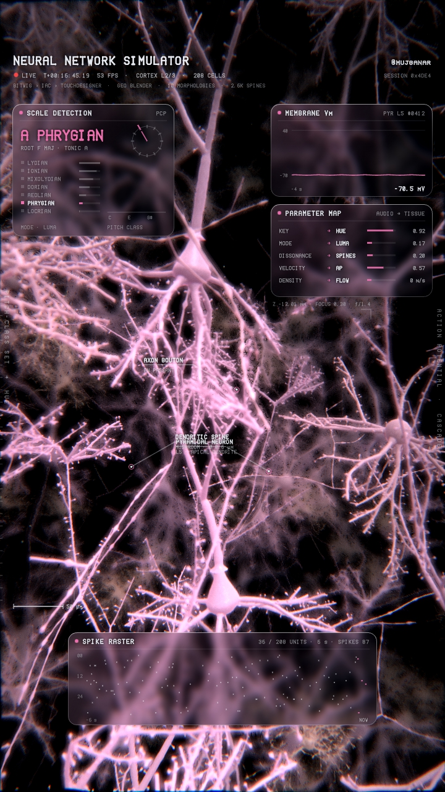
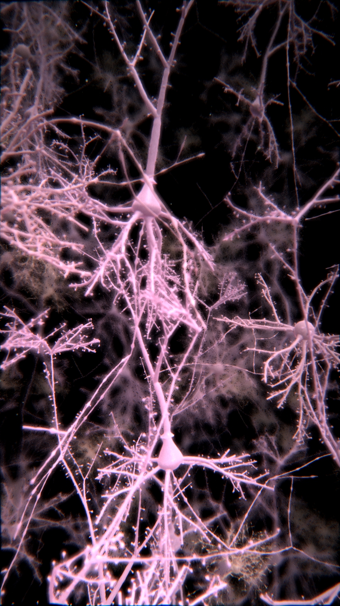
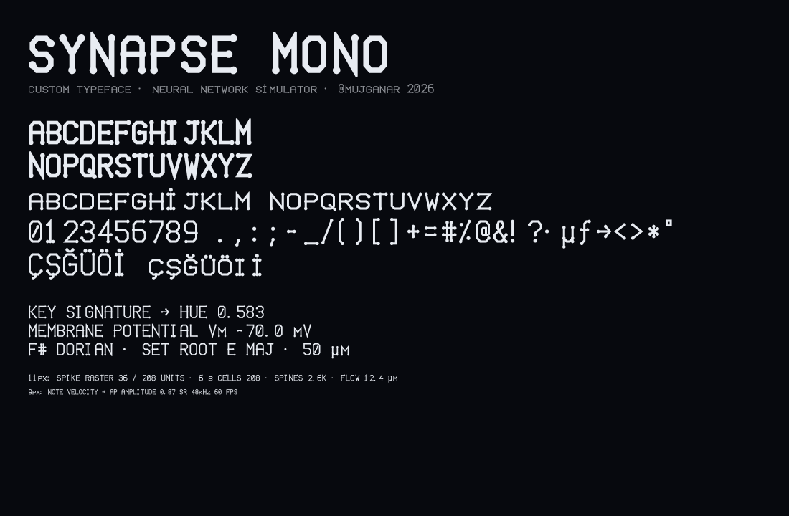

# Neural Network Simulator

A music-reactive journey through microscopic brain tissue. Neurons generated in **Blender**, rendered live in **TouchDesigner**, driven by **Bitwig** over MIDI — colour, texture and motion follow the musical scale being played.

by [@mujganar](https://github.com/mujganar)

<p align="center">
  
  &nbsp;
  
</p>

## What it does

- **Brain tissue in fluid** — 208 instanced neurons (pyramidal, stellate, astrocytes) plus 3,500 drifting vesicles, flowing endlessly past the camera with depth of field, refraction, caustics and fog.
- **Scale → colour** — incoming notes are reduced to a pitch-class set and matched to a key; the key's position on the circle of fifths sets the hue. The tonic within the set picks the mode (Lydian … Locrian), which sets brightness.
- **Notes → action potentials** — each note sends a velocity-weighted wave of firing through the cells; spontaneous background firing keeps the tissue alive between phrases.
- **Software-style HUD** — a "Neural Network Simulator" interface on floating glass panels: scale detection, membrane potential, parameter map and a live spike raster, set in a custom font.

## Pipeline

```
Keystation ─► Bitwig (synth + HW Instrument → IAC Driver) ─► TouchDesigner MIDI In
                     │                                          │
                     └─► Multi-Output (speaker + BlackHole) ─► Audio Device In ─► Movie File Out
Blender (procedural morphologies) ─► OBJ library ─► instanced GLSL tissue ─► post FX ─► HUD ─► OUT_IG
```

## Repository

| Path | Contents |
|---|---|
| `blender/neuron_library.py` | Procedural neuron morphology generator (random-walk branching, Rall's 3/2 rule, mushroom spines, boutons). Exports the OBJ library. |
| `blender/neurons.blend` | Blender file with the generated `NEURON_LIBRARY` collection. |
| `geo/library/` | 10 neuron OBJs (Y-up, origin at soma) + `library.json` metadata. |
| `touchdesigner/neuron_brain_ig.toe` | The live TouchDesigner project (720×1280 Instagram output). |
| `touchdesigner/build_brain.py` | Rebuilds the tissue: instancing, GLSL cell/particle shaders, DOF, fluid and grade. |
| `touchdesigner/hud/` | HUD page (`hud_v3.html`), TD ↔ HUD bridge, scale-detection brain, glass build script, fonts. |
| `font/synapse_font.py` | Generator for **Synapse Mono**, the custom HUD typeface (fontTools + shapely). |
| `tools/to_instagram.sh` | Converts a ProRes recording to H.264/AAC MP4 with macOS `avconvert`. |

## Running it

Requirements: macOS, TouchDesigner 2025, Blender 5.x, Bitwig Studio, [BlackHole 2ch](https://github.com/ExistentialAudio/BlackHole) for recording audio.

1. **MIDI** — enable the IAC Driver in Audio MIDI Setup. In Bitwig, add a *HW Instrument* sending to IAC, followed by any synth; set the track input to your keyboard only (not IAC, or it loops).
2. **TouchDesigner** — open `touchdesigner/neuron_brain_ig.toe`. MIDI In device 1 = IAC. The Perform window shows `OUT_IG`.
3. **Recording with sound** — create a Multi-Output Device (your speaker as primary + BlackHole 2ch with drift correction) and route Bitwig to it. In TD, `audio_in` reads BlackHole and feeds `moviefileout1`. TD Non-Commercial records ProRes 422 HQ + PCM; run `tools/to_instagram.sh <file>.mov` to get an upload-ready MP4.
4. **Regenerating geometry** (optional) — run `blender/neuron_library.py` in Blender's Text Editor, then `touchdesigner/build_brain.py` from the TD Textport.

> The scripts and the `.toe` use absolute paths from the original machine (`/Users/mujganar/VJ-PROJECTS/NEURON_SCALE/...`). Change `ROOT` in `build_brain.py` and `build_hud_v3.py`, the HUD Web Render URL and the OBJ paths in `library.json` to match your folder.

## Synapse Mono

A monospace display face drawn for this project: chamfered single-line skeletons where every free stroke end carries a round "synaptic bouton". Lowercase is set as small caps; Turkish characters included.

```
python font/synapse_font.py touchdesigner/hud/fonts
```

<p align="center"></p>

---

© 2026 Müjgan Armağan Türközü (@mujganar). All rights reserved.
